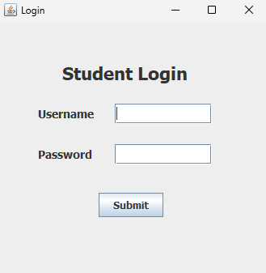
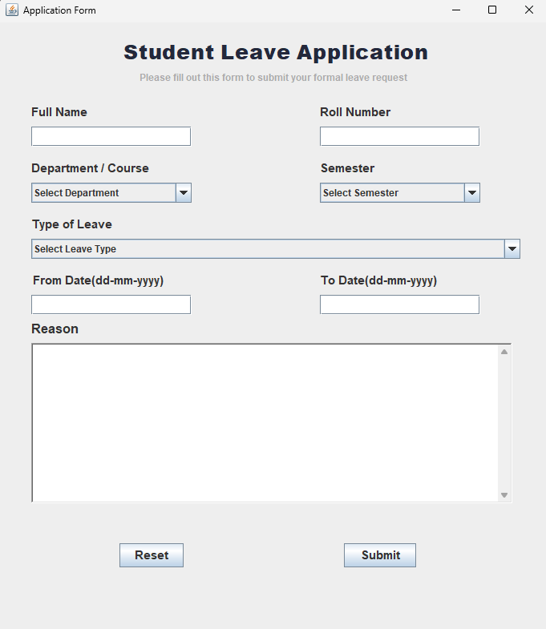
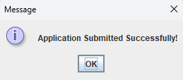

# College Leave Application System

A Java-based desktop application developed to simplify the college leave application process. Students can log in, fill out their leave application details, and submit applications. The application uses Java Swing/AWT for its graphical user interface and MySQL for storing application details through JDBC.

## 📸 Screenshots

### 1. Login Form


### 2. College Leave Application Form


### 3. Successful Submission



---

## 🚀 Features

- User login system.
- Opens the Leave Application Form after successful login.
- Displays an error message for incorrect login details.
- Student name and roll number input.
- Department selection.
- Semester selection.
- Leave type selection.
- From-date and To-date input.
- Leave reason text area.
- Date validation.
- Stores leave applications in MySQL database.
- Success message after submitting an application.
- Automatically closes the form after successful submission.
- Reset button clears all fields.

## 🛠️ Technologies Used

- Java
- Java Swing
- Java AWT
- MySQL
- JDBC
- IntelliJ IDEA

## 📂 Project Structure

```text
College-Leave-Application-System/
│
├── src/
│   ├── UserLoginForm.java
│   ├── LeaveForm.java
│   └── DBConnection.java
│
├── login-form.png
├── leave-form.png
├── submission-success.png
│
└── README.md
```

## 🗄️ Database Setup

First, create a database in MySQL:

```sql
CREATE DATABASE application;
```

Select the database:

```sql
USE application;
```

Create the table:

```sql
CREATE TABLE form (
    id INT AUTO_INCREMENT PRIMARY KEY,
    student_name VARCHAR(100),
    roll_number VARCHAR(30),
    department VARCHAR(100),
    semester VARCHAR(30),
    type_of_leave VARCHAR(50),
    from_date DATE,
    end_date DATE,
    reason VARCHAR(500)
);
```

## 🔌 Database Connection

The project uses JDBC to connect Java with MySQL.

Example connection code:

```java
import java.sql.Connection;
import java.sql.DriverManager;
import java.sql.SQLException;

public class DBConnection {

    public static Connection getConnection() throws SQLException {

        String url = "jdbc:mysql://localhost:3306/application";
        String user = "YOUR_USERNAME";
        String password = "YOUR_PASSWORD";

        return DriverManager.getConnection(url, user, password);
    }
}
```

Replace the username and password with your own MySQL credentials.


## ▶️ How to Run the Project

1. Install JDK on your computer.
2. Install MySQL Server and MySQL Workbench.
3. Create the `application` database and `form` table.
4. Add MySQL Connector/J to your Java project.
5. Configure the database connection in `DBConnection.java`.
6. Open the project in IntelliJ IDEA.
7. Run `UserLoginForm.java`.
8. Enter your login credentials.
9. After successful login, the College Leave Application Form will open.
10. Fill in the details and click Submit.

## 🔑 Login Credentials

If you are using the demonstration credentials in your current code:

- **Username:** admin
- **Password:** 1234

You can change these credentials in `UserLoginForm.java`.


## 📅 Date Format

The application accepts dates in the following format:

`dd-MM-yyyy`

Example: `07-11-2026`

## 🔮 Future Improvements

- Database-based user authentication.
- Admin dashboard.
- View all submitted leave applications.
- Update and delete applications.
- Improved graphical user interface.
- Better input validation.

## 👨‍💻 Author

**Arpit Deva**

B.Tech – Computer Science Engineering

## 📄 License

This project is developed for educational and learning purposes.
